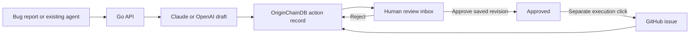

# Agent Action Inbox

A small Go service that turns bug reports into **reviewable GitHub issue proposals** using Claude or OpenAI. A person edits and approves the draft before a separate execution step creates the issue. OriginChainDB Cloud stores the action, its reviewed revisions, and the outcome.

**Verified on 21 October 2026:** real Claude API drafting, OriginChainDB **Cloud Free** persistence, and an approved [GitHub issue](https://github.com/originchaindb/agent-action-inbox/issues/1). Restart, rejection, duplicate-execution, and reconciliation checks passed. See the [test report](docs/VERIFICATION.md) and [sanitized receipt](docs/live-verification.json). The application was run locally against cloud services; there is no hosted public demo yet.

The interface is a neutral **Agent Action Inbox** workspace. Database and model details appear in Settings. Screenshots in the verification report document the earlier live test and retain its original appearance.

## Why build this?

For a startup founder, a useful first agent workflow is turning a messy support report into an engineering issue. The hard part is keeping an uncertain AI interpretation from becoming an external action without review.

This starter gives you a concrete place to pause:

1. Paste a bug report or send it from your existing agent.
2. Claude drafts a title, issue body, and short review guidance. OpenAI is also supported.
3. Review the original report, edit the draft, and approve or reject it.
4. Click **Create GitHub issue** to execute the exact saved approval.
5. Keep the decisions and result in OriginChainDB, including after an application restart.

The first integration is intentionally narrow: one operator-configured GitHub repository. The model cannot choose a URL, obtain the GitHub token, approve itself, or call arbitrary tools.



## What is included

- A small inbox, action details with saved revision history, and a connection settings page.
- Claude Messages and OpenAI Responses integrations using structured JSON output.
- A manual proposal API for agents that already generate their own drafts.
- Distinct reviewer and agent access keys. Agents can submit proposals only.
- Stable request IDs, stale-review detection, and no automatic external-action retries.
- An isolated Cloud Free smoke test, a CI workflow, a Dockerfile, and [production setup](docs/PRODUCTION.md).
- No Ollama, local model download, frontend build system, or external JavaScript CDN.

## Run locally against OriginChainDB Cloud Free

You need Go 1.24 or newer (development checks use Go 1.26.2), an [OriginChainDB Cloud Free instance](https://app.originchaindb.com/instances), and API access to your chosen model provider. Provider API usage and application hosting are separate from the database's free plan. Check current account limits in the console and [pricing page](https://originchaindb.com/pricing).

Clone the starter:

```sh
git clone https://github.com/originchaindb/agent-action-inbox.git
cd agent-action-inbox
cp .env.example .env
go mod download
```

On Windows, use `Copy-Item .env.example .env`. Edit the ignored `.env` file locally:

| Setting | Value |
| --- | --- |
| `OC_BASE_URL` | HTTPS instance origin from **Connect → Application API**, without a path |
| `OC_TENANT` | Tenant from the connection example, not the instance ID |
| `OC_BEARER` | Existing instance API key |
| `OC_NAMESPACE` | A fresh application namespace; keep it stable across restarts |
| `AI_PROVIDER` | `claude` (default) or `openai` |
| `AI_MODEL` | Tested: `claude-haiku-4-5-20251001`; confirm availability in your API account |
| `ANTHROPIC_API_KEY` | Claude API key when using Claude |
| `OPENAI_API_KEY` | OpenAI API key when using OpenAI |
| `GITHUB_REPOSITORY` | `owner/demo-repository`, controlled by you |
| `REVIEWER_TOKEN` / `AGENT_TOKEN` | Two different random secrets, each at least 32 characters |
| `AI_REQUEST_LIMIT` | Maximum provider attempts; defaults to 3 for initial verification |
| `AI_REQUEST_LEDGER` | Persistent local counter file; defaults to `.local/ai-requests.json` |

Run `go run ./cmd/keygen` twice in your own terminal to generate the two app access keys. Copy each result into the appropriate setting; do not commit or share them. Provider keys belong in server configuration, never in browser JavaScript or an agent's prompt.

Leave `ENABLE_GITHUB_EXECUTION=false` initially. A missing AI key/model disables AI drafting; you can still submit a manual draft and exercise human review against your cloud database.

The request ceiling counts attempts **before** sending them, including failures, and survives restarts when the ledger is retained. Reaching it blocks another provider call. This is a request cap, not an account-wide dollar cap: set a provider [workspace spend limit](https://platform.claude.com/docs/en/manage-claude/workspaces) for billing enforcement, and only raise the request limit after reviewing model costs. Do not delete the ledger to recover from an uncertain request.

```sh
go run ./cmd/inbox
```

Open **http://127.0.0.1:8087**, enter `REVIEWER_TOKEN`, and select **New proposal → Use synthetic example**. The app starts by verifying the schema; it does not fall back to a local database. The settings page checks the database, while “AI configured” only means a key and model are present.

Switching to OpenAI requires `AI_PROVIDER=openai`, an appropriate `AI_MODEL`, and `OPENAI_API_KEY`, followed by a server restart. There is no automatic provider fallback. This is an API integration, not a connection to your ChatGPT or Claude browser session.

## Enable the first GitHub action

Use a disposable repository you own. Create a fine-grained GitHub token scoped to **that repository only**, with **Issues: read and write**. Store it as `GITHUB_TOKEN`, set `ENABLE_GITHUB_EXECUTION=true`, and restart the app.

Review a synthetic proposal, approve it, and click **Create GitHub issue**. Inspect the issue and compare it with the approved content. The app appends a hidden action marker for reconciliation. This action creates a real issue and may trigger repository notifications and automations.

The server never retries issue creation automatically. If an attempt times out, it might already have succeeded at GitHub. Check the target repository and use **Verify existing issue** with its issue number. Do not create a replacement until you have resolved the uncertain outcome.

## Connect another agent

Send `POST /api/actions` with `Authorization: Bearer <AGENT_TOKEN>` and a stable `request_id`. Omit `draft` to have the configured model draft the proposal, or include a title/body/rationale to submit an existing draft. The agent key cannot approve, execute, or browse the inbox.

See [the API examples](docs/API.md). Any Python, Rust, or Go agent that can make an HTTP request can use this interface.

## Tests and limits

The live test demonstrated why review matters: Claude suggested reproduction steps that the source report did not establish. The reviewer removed them before approving the issue; both the generated draft and the approved revision remain in the database history. Structured JSON makes output parseable, not necessarily correct.

```sh
go test ./...
go vet ./...
go build ./cmd/inbox
```

On a host with a supported C compiler, also run `go test -race ./...`. CI is configured to do this on Linux. Live tests are explicit opt-ins; normal tests do not spend model credits or create cloud data. See [verification instructions and results](docs/VERIFICATION.md).

This is a **single-writer internal-tool starter**, not a multi-tenant SaaS or an exactly-once execution system. Run one server process per namespace. It has no distributed lock or transactional commit spanning GitHub and the database. The inbox shows the latest 50 actions; older action records remain retrievable by ID. The history records roles, not individually authenticated reviewer identities, and is not a tamper-proof audit log.

## References

- [OriginChainDB HTTP API](https://originchaindb.com/docs/api): schemas, row upserts, and SQL used by the persistence adapter.
- [Claude Messages API](https://platform.claude.com/docs/en/api/messages/create) and [structured outputs](https://platform.claude.com/docs/en/build-with-claude/structured-outputs): drafting request and result format.
- [OpenAI structured outputs](https://developers.openai.com/api/docs/guides/structured-outputs): Responses API alternative, including refusal/incomplete handling.
- [GitHub Issues REST API](https://docs.github.com/en/rest/issues/issues#create-an-issue): the approved side effect and reconciliation reads.

MIT licensed. Contributions should include focused tests for changes to approval or execution behavior.
